<table border="0">
<tr>
<td width="65%" valign="middle">

- Embedded systems + firmware, with a side of control systems and ML
- Into real-time systems, low-level peripherals (DMA, SPI, UART), and inference on constrained hardware
- **Mechatronics Wing Lead** @ Connexion
- **Payload & Design** @ Student Satellite Group
- Currently learning **STM32**

</td>
<td width="35%" align="center" valign="middle">

</td>
</tr>
</table>

---

### toolbox

  

---

### featured projects

<table>
<tr>
<td width="50%" valign="top">

#### [ESP32 DMA Snake Game](https://github.com/Lilac-dot/ESP32-DMA-Snake-Game)
Real-time graphics engine with a custom framebuffer and DMA-driven SPI rendering.
 `ESP-IDF` `FreeRTOS` `C/C++`

</td>
<td width="50%" valign="top">

#### [Eczema Detection](https://github.com/Lilac-dot/eczema-detection)
Wearable-oriented detection pipeline combining image and tabular models.
 `PyTorch` `ResNet18` `LightGBM`

</td>
</tr>
<tr>
<td width="50%" valign="top">

#### [PID Beam Balancer](https://github.com/Lilac-dot/PID-Beam-Balancer)
Ball-and-beam stabilised with PID, servo actuation and ultrasonic feedback.
 `Arduino` `C++` `MATLAB`

</td>
<td width="50%" valign="top">

#### [QCA Time-to-Digital Converter](https://github.com/Lilac-dot/Time-to-Digital-Converter-QCA)
Reproduction of a low-power QCA TDC from a 2025 IEEE Access paper.
 `QCADesigner`

</td>
</tr>
<tr>
<td width="50%" valign="top">

#### [Mic Amplifier w/ Class AB Driver](https://github.com/Lilac-dot/Microphone-Amplifier-with-Class-AB-Driver)
Analog mic preamp with a Class AB output stage, simulated in SPICE.
 `LTspice`

</td>
<td width="50%" valign="top">

#### [Home Automation System](https://github.com/Lilac-dot/Home-Automation-System)
Sensor-driven automation with an Arduino controller + ESP8266 node.
 `Arduino` `ESP8266` `C++`

</td>
</tr>
</table>

---

### currently building

- **GroundWatch** - seismic intrusion detection: 8051 RTOS for sensing/alerts + FPGA co-processor for INT8 inference over UART *(team)*
- **STM32H743 audio device** - firmware for a team hardware project

---

### a snake eating my contributions

<picture>
  <source media="(prefers-color-scheme: dark)" srcset="https://raw.githubusercontent.com/Lilac-dot/Lilac-dot/output/github-snake-dark.svg" />
  <source media="(prefers-color-scheme: light)" srcset="https://raw.githubusercontent.com/Lilac-dot/Lilac-dot/output/github-snake.svg" />
  
</picture>

Snake by <a href="https://github.com/Platane/snk">Platane/snk</a> (MIT). Pixel cat is original.
