<table border="0">
<tr>
<td width="65%" valign="middle">

</td>
<td width="35%" align="center" valign="middle">

</td>
</tr>
</table>

---

### `§1` general description

Embedded engineer, student grade. Runs best close to the metal: real-time systems, low-level peripherals, and ML inference squeezed onto constrained hardware. Side modules in control systems.

### `§2` pin configuration

| pin | signal | function |
|:---:|:---|:---|
| `1` | `MECH_LEAD` | Mechatronics Wing Lead @ Connexion |
| `2` | `SAT_PAYLOAD` | Payload & Design @ Student Satellite Group |
| `3` | `EDU` | B.Tech ECE @ IIIT Sri City · 2024–28 |
| `4` | `DBG` | currently learning **STM32** |

### `§3` supported toolchain

  

### `§4` firmware in development

| build | stage |
|:---|:---:|
| **GroundWatch** · seismic intrusion detection: 8051 RTOS for sensing/alerts + FPGA co-processor for INT8 inference over UART *(team)* | `in dev` |
| **Walkman** · STM32H743 audio player firmware *(team)* | `bring-up` |

> finished projects → **pinned repos below** ↓

### `§5` errata

| id | issue | workaround |
|:---:|:---|:---|
| `E1` | will bring up DMA unprompted | none known |

---

### a snake eating my contributions

<picture>
  <source media="(prefers-color-scheme: dark)" srcset="https://raw.githubusercontent.com/Lilac-dot/Lilac-dot/output/github-snake-dark.svg" />
  <source media="(prefers-color-scheme: light)" srcset="https://raw.githubusercontent.com/Lilac-dot/Lilac-dot/output/github-snake.svg" />
  
</picture>

Snake by <a href="https://github.com/Platane/snk">Platane/snk</a> (MIT). Pixel cat and boot log are original.
